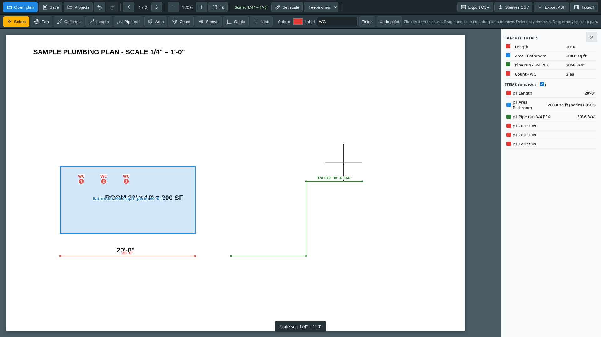
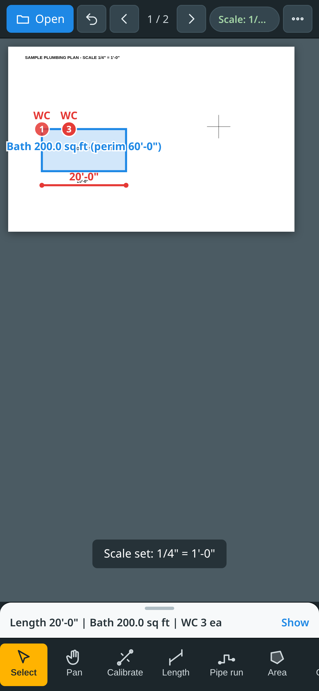
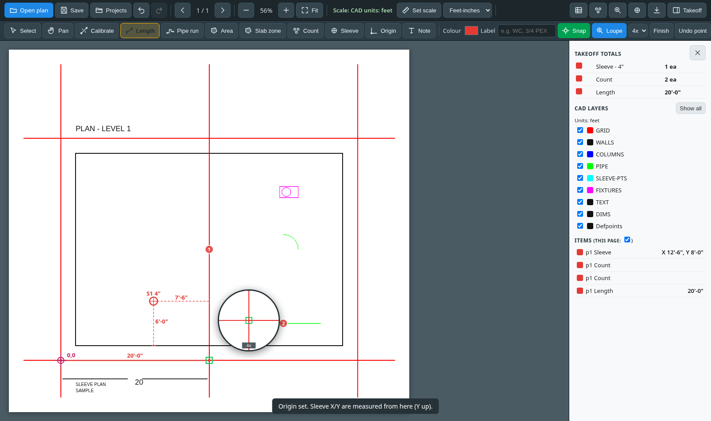
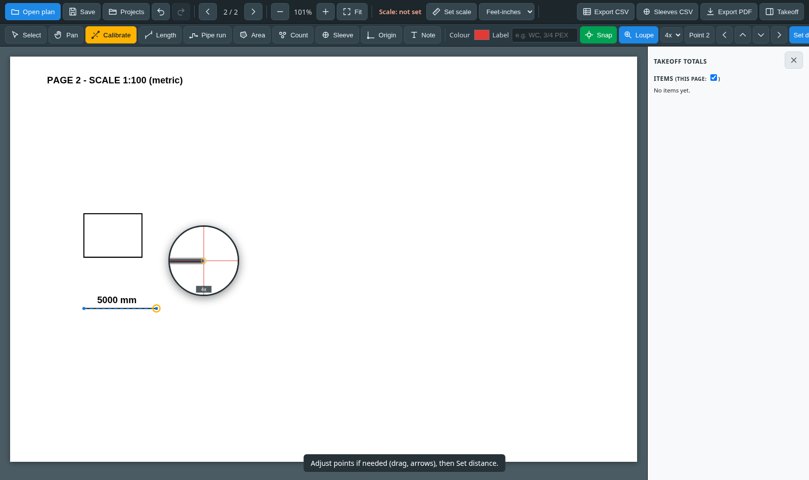

# Plan Measure

A free, browser-only plan viewer and takeoff tool for the trades: open PDF, image, DXF and DWG plans, set the scale, and measure, count and lay out sleeves without uploading anything.

**Live app:** https://plan-measure.pages.dev

Everything runs on your device. Files are opened locally in the browser and projects are saved in the browser's own storage. There is no server, account or paid service.

## Screenshots

| Desktop takeoff | Phone |
| --- | --- |
|  |  |

| CAD drawing with sleeves | Magnifier during calibration |
| --- | --- |
|  |  |

## Features

**Plans**
- Open PDF (multi-page), PNG/JPG, DXF and DWG files entirely client-side
- Zoom, pan, pinch-zoom and two-finger pan; fit to page; page navigation
- CAD layer list with on/off toggles; true scale read from the drawing units (`$INSUNITS`), with a manual override for unitless drawings

**Scale**
- Per-page calibration: click two points and type a known distance (`12'6"`, `12' 6 1/2"`, `20ft`, `3.5m`, `3500mm`)
- Standard architectural, engineering and metric scales (1/4" = 1'-0", 1" = 20', 1:100, and more)
- Feet-inches or metric display

**Takeoff tools**
- Length, pipe run (polyline), area with perimeter, fixture counts with labels and colours, text notes
- Sleeve tool: size, label and note; X/Y from a user-set origin; automatic offsets to the nearest walls or gridlines
- Takeoff panel with totals per type, label and colour
- Select, move, edit and delete markups; drag individual points

**Precision**
- Snapping to drawing geometry: endpoints, intersections, points on a line, plus CAD midpoints and circle centres; markers shown on the plan and in the loupe
- Snaps use real vector data from PDFs (pdf.js operator lists) and DXF/DWG entities; image plans use dark-line detection
- Magnifier loupe (2x to 8x) rendered from the full-resolution plan; on touch, press and drag with the loupe above your finger
- Shift for straight horizontal/vertical lines, Alt to place a point without snapping, arrow-key or on-screen nudge for calibration points

**Workflow**
- Undo and redo (100 steps) for every change, including scale and layer changes
- Autosave of projects (plan file included) in IndexedDB; project list to reopen or delete
- Export takeoff CSV, sleeve schedule CSV, and a marked-up PDF with a summary page
- Responsive layout: desktop toolbar with collapsible panel; phone layout with compact top bar, bottom tool bar, contextual drawing bar and takeoff bottom sheet

## Tech stack

- Plain HTML, CSS and JavaScript; no build step and no framework
- [pdf.js](https://github.com/mozilla/pdf.js) for PDF rendering and vector geometry extraction
- [pdf-lib](https://github.com/Hopding/pdf-lib) for marked-up PDF export
- [dxf-parser](https://github.com/gdsestimating/dxf-parser) for DXF files
- [libredwg-web](https://github.com/mlightcad/libredwg-web) (GNU LibreDWG compiled to WebAssembly) for DWG files, loaded only when a DWG is opened
- [Cloudflare Pages](https://pages.cloudflare.com/) for free static hosting
- [Playwright](https://playwright.dev/) for end-to-end tests

All libraries are vendored in `lib/`, so the app works without any CDN.

## Run locally

Any static file server works:

```bash
git clone https://github.com/lorplace/plan-measure.git
cd plan-measure
python3 -m http.server 8000
# open http://localhost:8000
```

## Tests

The tests drive the real app in Chrome with Playwright and check measurements against plans with known dimensions (calibration, lengths and areas within 1%, CAD coordinates exact).

```bash
pip install playwright reportlab ezdxf
python3 -m playwright install chromium

python3 test/make_sample.py   # sample PDF plan with known dimensions
python3 test/make_dxf.py      # sample DXF plans in feet, mm and unitless

python3 -m http.server 8766 &
python3 test/e2e.py                                  # starts its own server
for t in phone loupe undo snap cad; do python3 test/$t.py http://127.0.0.1:8766/; done
```

The tests launch Chrome from `/usr/bin/google-chrome`; change `executable_path` in the scripts if yours is elsewhere. The DWG checks in `test/cad.py` expect sample files from the LibreDWG test data (`example_2018.dwg`, `example_r14.dwg`) in `/tmp` as `ex_2018.dwg` and `ex_r14.dwg`.

## Deploy

The site is static. To deploy on Cloudflare Pages, upload `index.html`, `style.css`, `app.js`, `units.js`, `cad.js` and `lib/`, for example:

```bash
npx wrangler pages deploy <folder> --project-name plan-measure
```

## Limitations

- DWG support depends on LibreDWG; some files (often older versions) cannot be read, and the app then suggests saving as DXF
- Hatches, solids, tables and multileaders in CAD files are not drawn
- Projects are stored only in the browser where they were created

## Licence

GPL-3.0. See [LICENSE](LICENSE). The project bundles libredwg-web, which is GPL-3.0, so the whole app is distributed under the same licence. pdf.js (Apache-2.0), pdf-lib (MIT) and dxf-parser (MIT) are used under their own compatible licences.
