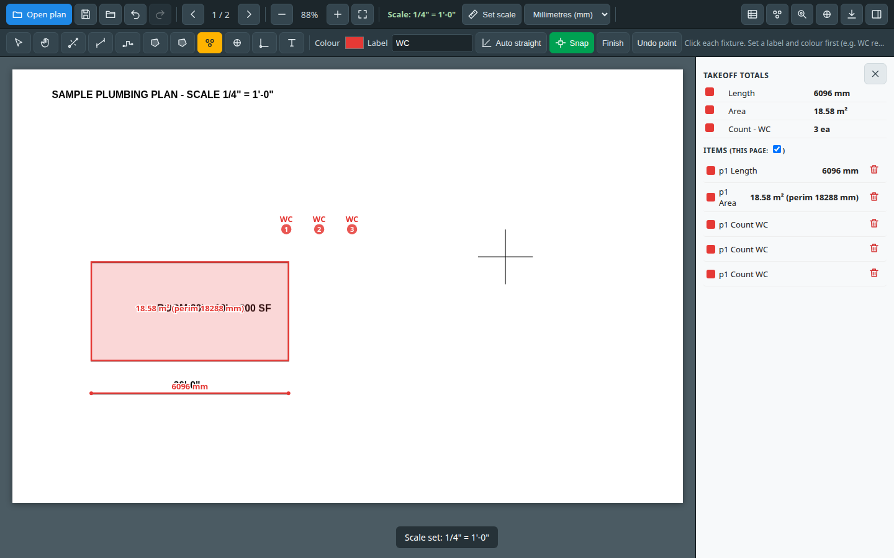
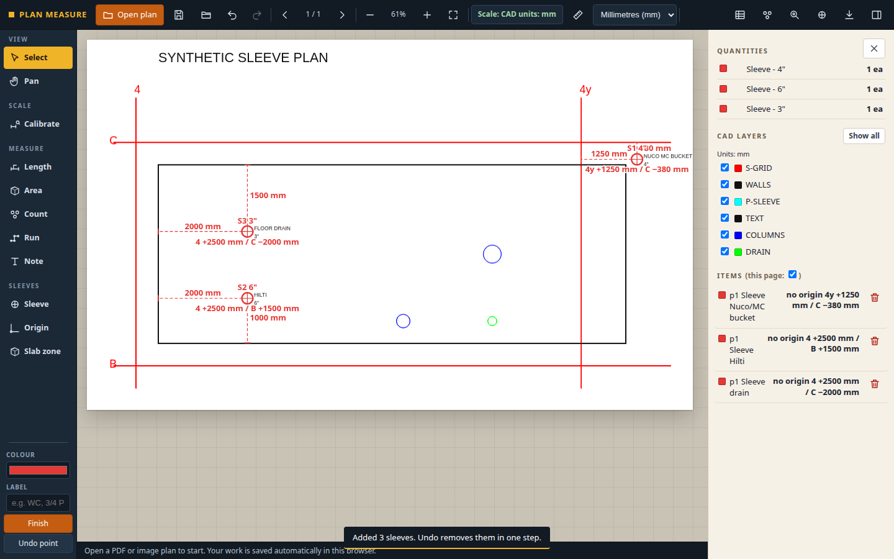
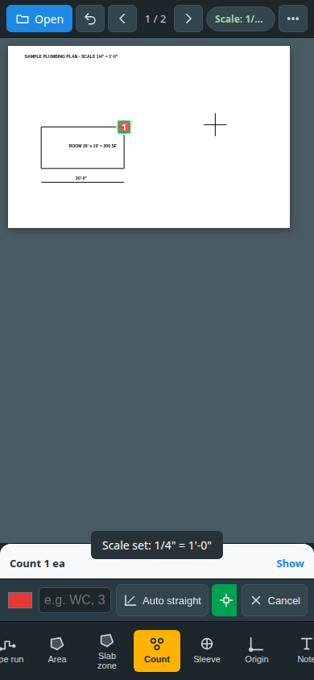
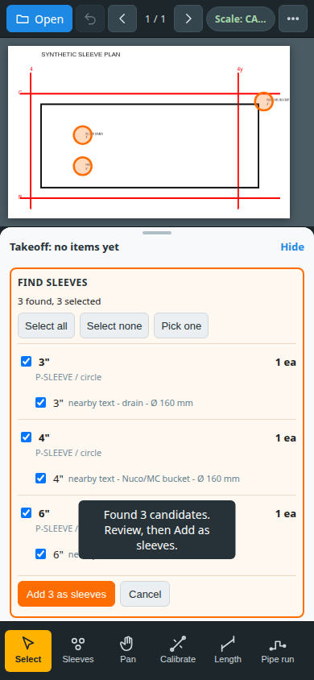
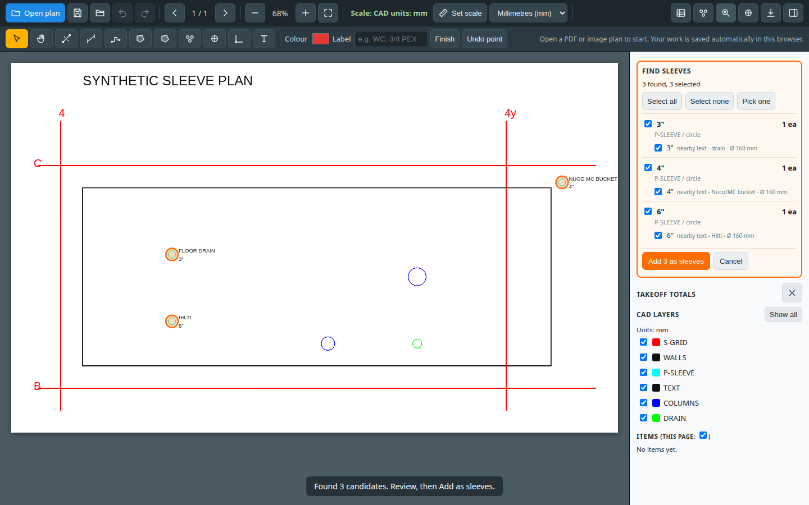

# Plan Measure

Plan Measure is a free browser app for construction takeoffs. Open a PDF or a DXF/DWG plan, set the scale, and measure lengths, areas, counts, pipe runs and sleeves. Files stay on the device: there is no account, upload or server.

**Live demo:** https://plan-measure.pages.dev

It is a portfolio project by a plumber who wants to work in AI and construction technology.

## Features

**Plans**

- Open PDF (multi-page), PNG/JPG, DXF and DWG entirely in the browser
- Revit-style exports: geometry inside link blocks, mirrored families, hatch outlines, and a view that ignores stray far-away entities
- Zoom, pan, pinch-zoom, fit and page navigation
- CAD layer list. True scale comes from the drawing units (`$INSUNITS`), with a manual override for unitless files
- Millimetres are the default. Lengths are in mm and areas are in m². Switch to metres or feet-inches per project. A CAD file opens in the drawing's own units

**Scale**

- Calibrate a page by clicking two points and typing a known distance (`12'6"`, `12' 6 1/2"`, `20ft`, `3.5m`, `3500mm`)
- Standard architectural, engineering and metric scales (1/4" = 1'-0", 1" = 20', 1:100, and others)

**Takeoff**

- Length, pipe run (with extra for drops and fittings), area with perimeter, fixture counts, and text notes
- Totals by type, label and colour
- Sleeve tool: size, label, note, X/Y from a chosen origin, and the distance to the nearest walls or gridlines
- Named gridlines produce a location such as `4y +1250 mm / C −380 mm` (vertical grid, then horizontal grid)
- Sleeve heights from a level default, a slab zone, nearby elevation text, or a per-sleeve override
- Find sleeves in DXF/DWG from block names, layers and circles. Sizes are read from attributes, the block name, nearby drawing text, or the circle diameter. Symbols are classified as Nuco/MC bucket, Hilti or drain when the drawing says so
- Review found sleeves by size, include or exclude them, and add them in one undoable step
- Sleeve count by size, layer and level, plus CSV and a marked-up PDF

**Precision**

- Snap to endpoints, midpoints, intersections, centres and points on a line. PDF plans use vector geometry; images use the dark lines
- Magnifier from 2x to 8x. On a phone, press and drag with the loupe above your finger
- Auto straight (on by default) locks Length, Pipe run, Area and Calibrate to level, plumb or 45 degrees when the cursor is within 5 degrees, and lines the point up with existing points. Hold Alt to place freely. Shift forces horizontal or vertical

**Workflow**

- Undo and redo for measurements, scale and layer changes
- Autosave in the browser, plus a `.pmproj` file so a DWG opened on a computer can be measured on a phone without converting it again
- Export takeoff CSV, a sleeve schedule CSV, and a marked-up PDF
- Full screen for the plan. Desktop and Android use the fullscreen view; iPhone Safari hides the tool rail and panels and shows an exit button
- Print the current sheet with its measurement labels, fitted to the page. A wide sheet prints landscape and a tall sheet prints portrait. The quantities list can go on a second page
- Desktop tool rail grouped as View, Scale, Measure and Sleeves, with a quantities panel. On a phone: compact top bar, large bottom tools, a drawing bar and a takeoff sheet

## Screenshots

Taken from the local app using the synthetic plans in `test/` (`sample-plan.pdf` and `sample-grid.dxf`).

| Desktop takeoff | Desktop sleeves |
| --- | --- |
|  |  |

| Phone | Find sleeves on a phone |
| --- | --- |
|  |  |

The sleeve review before they are added:



## Quick start

Any static file server works. From the repository root:

```bash
git clone https://github.com/lorplace/plan-measure.git
cd plan-measure
python3 -m http.server 8000
```

Open http://localhost:8000 and use **Open plan**. Two synthetic files are included:

- `test/sample-plan.pdf` — architectural sheet. Set scale to 1/4" = 1'-0" and measure the 20 ft line and the 20 ft by 10 ft room
- `test/sample-grid.dxf` — millimetre CAD plan with grid bubbles `4`, `4y`, `B` and `C`, and three sleeve notes

The plans under `test/` are synthetic. Do not add PDF, DWG or DXF files from real jobs.

## Tests

Unit tests use [Vitest](https://vitest.dev/) and cover scale calibration, millimetre lengths and square-metre areas, length / area / count math, level / plumb / 45 degree snapping, sleeve detection and type, and gridline offsets.

```bash
npm install
npm test
```

GitHub Actions runs `npm test` on every push and pull request (`.github/workflows/test.yml`).

`test/*.py` are optional browser checks from earlier development. They drive Chrome through Playwright against a local server and are not part of CI. Regenerating a synthetic DXF needs Python and `ezdxf` (`python3 test/make_grid_dxf.py` and the other `test/make_*.py` scripts).

## Tech stack

- Plain HTML, CSS and JavaScript. No framework and no build step for the app itself
- [pdf.js](https://github.com/mozilla/pdf.js) for PDF rendering and vector geometry
- [pdf-lib](https://github.com/Hopding/pdf-lib) for marked-up PDF export
- [dxf-parser](https://github.com/gdsestimating/dxf-parser) for DXF
- [libredwg-web](https://github.com/mlightcad/libredwg-web) (GNU LibreDWG as WebAssembly) for DWG, loaded only when a DWG is opened
- [Vitest](https://vitest.dev/) for the unit tests
- [Cloudflare Pages](https://pages.cloudflare.com/) for static hosting

Libraries are vendored in `lib/`, so the app does not depend on a CDN. Measurement code that used to sit inside `app.js` now lives in `units.js`, `measure.js`, `straight.js`, `sleeves.js` and `grid.js`. The page behaviour is unchanged; those modules are what the tests call.

## Roadmap

- A small fitting library (elbows, tees, hangers) on top of the extra-length field pipe runs already have
- Dimension and leader text from CAD, not only the grid bubbles used for sleeve callouts
- Project files that can be shared, not only stored in one browser
- An installable offline copy for a job site with poor reception

## Limitations

- DWG support depends on LibreDWG. Some files, often older ones, cannot be read; save them as DXF
- Hatches are drawn as outlines. Solids, tables and multileaders are not drawn
- Projects saved in the browser stay in that browser. Use **Save project file** to move one

## Licence

GPL-3.0. See [LICENSE](LICENSE). The app bundles libredwg-web, which is GPL-3.0, so the project is distributed under the same licence. pdf.js (Apache-2.0), pdf-lib (MIT) and dxf-parser (MIT) stay under their own licences.
